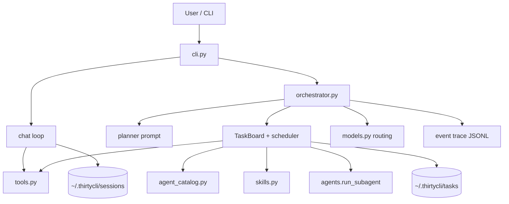

# ThirtyCLI — Target Architecture

Tujuan: menambah kemampuan multi-agent tanpa mengganti chat, provider, tool, session, dan TUI yang sudah bekerja.

## Prinsip

1. **Additive**: modul baru (`orchestrator`, `agent_catalog`, `skills`) dan perluasan `tools`/`models`; `phases`, `team`, chat loop lama tetap ada.
2. **Realitas di atas demo**: status task hanya berubah setelah runner mengembalikan hasil; tidak ada progress palsu.
3. **Lokal dulu**: orchestration berjalan di proses CLI. Tidak butuh LangSmith/managed service.
4. **Aman secara default**: worker memakai tool read-only; tool mutasi tetap lewat approval chat.
5. **Deterministik**: dependency, retry, routing, dan seleksi agent punya aturan yang bisa dijelaskan.

## Diagram komponen



## Kontrak antarmodul

### AgentProfile (`agent_catalog.py`)

```python
AgentProfile(
  id, name, description, instructions,
  allowed_tools: tuple[str, ...] | None,
  model: str,
  permission: "read-only" | "controlled" | "autonomous",
  context_policy: str,
  output_contract: str,
)
```

- `select_agents(text, limit)` memilih profil dari trigger deterministik; fallback `coder`.
- `agent_system_prompt(profile, skills)` menyusun prompt final.

### Skill (`skills.py`)

- `select_skills(text, limit)` hanya memuat skill yang keyword-nya cocok.
- `skill_context(text, limit)` menghasilkan blok prompt; tidak ada dump seluruh registry.

### Task (`orchestrator.py`)

Field wajib: `id`, `title`, `description`, `agent`, `depends_on`, `status`, `output`, `error`, `attempts`, `max_retries`, `started`, `finished`.

Status: `pending → ready → running → completed`, plus `waiting` (retry), `failed`, `cancelled`, `blocked`.

### TaskBoard

- `ready()`: task pending yang semua dependensinya completed.
- `refresh_blocked()`: memblokir task yang dependensinya gagal/cancel/blocked.
- `save/load`: JSON atomik sederhana di `~/.thirtycli/tasks/<run_id>.json`.
- `summary()`: hitungan task/usage untuk CLI.

### Orchestrator

```python
Orchestrator(
  model=None, root=Path.cwd(), workers=3, max_steps=4, max_retries=1,
  max_tasks=6, planner=None, runner=None, on_event=None, cancel=None,
  persist=True, task_dir=None,
)
```

- `planner(goal, limit) -> list[spec|Task]`; default memakai LLM JSON.
- `runner(task, board) -> str`; default memakai `run_subagent` + agent prompt + skills + read-only tools.
- `run(goal, resume=run_id)` menjalankan scheduler dan merge.
- `on_event(dict)` untuk UI/log; event juga ditulis ke `<run>.events.jsonl`.

## Scheduler

1. Planner menghasilkan DAG; dependency yang tidak valid/cycle dipotong deterministik.
2. `ready()` mengembalikan task yang dependensinya selesai.
3. `ThreadPoolExecutor(max_workers=workers)` menjalankan task; tidak ada thread untuk task yang belum ready.
4. Selesai/gagal → board disimpan; dependen yang gagal menjadi `blocked`.
5. Semua selesai/gagal/cancel → merge hasil completed, sebutkan task yang gagal.
6. Resume mereset task non-completed ke `pending`; completed tidak diulang.

## Planner dan fallback

- Prompt meminta JSON array `{id,title,description,agent,depends_on,max_retries}`.
- `parse_plan` memvalidasi id, agent, dependency, dan limit.
- JSON rusak/kosong → satu task dengan agent hasil `select_agents`.
- Tidak ada klaim sukses tanpa output runner.

## Model routing

- `capabilities(provider, model)` memberi metadata konservatif untuk model tak dikenal.
- `route_model(cfg, …, allow_switch=False)` default mempertahankan config.
- Perpindahan provider hanya jika `allow_switch=True` atau fallback yang dikonfigurasi.
- Provider tanpa key disaring.

## Persistence dan recovery

- Board JSON berisi goal, task, status, output, usage, final.
- Event JSONL untuk observability; nilai sensitif di-redact.
- Session chat tetap di `sessions/`; run orchestration juga membuat session ringkas.
- Session/task kosong tidak ditulis.

## Keamanan

- Worker default read-only; `delete_file`, `git_commit`, `run_shell`, `write_file`, `edit_file` tidak masuk `READONLY_NAMES`.
- `delete_file` menolak path di luar workspace, root, dan symlink.
- Approval chat tetap berlaku untuk write/edit/shell; tool mutasi baru perlu ditambahkan ke `MUTATING_TOOLS` bila dipakai dari chat.
- Redaksi key di semua output UI dan event.
- Sandbox OS belum ada; ini batasan yang harus diselesaikan sebelum mode autonomous penuh.

## Trade-off

- **Tidak memakai LangGraph/Deep Agents** karena belum terpasang dan fitur yang dibutuhkan (DAG, retry, persist) bisa diimplementasikan kecil dan teruji di `orchestrator.py`. Integrasi keduanya bisa ditambahkan sebagai backend runner tanpa mengubah kontrak.
- **Worker read-only** menjaga keamanan; coding otomatis dengan write harus melalui lapisan approval/sandbox berikutnya.
- **TUI dashboard** belum memakai event orchestrator; CLI `run` menampilkan status real-time di scrollback.
